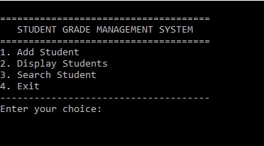
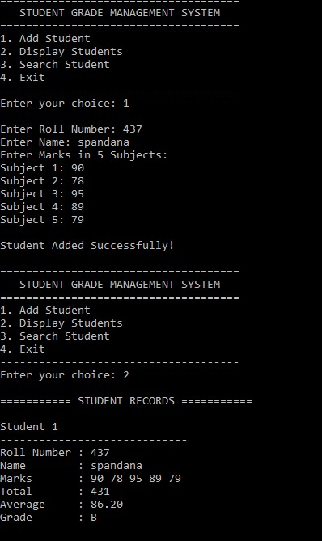

# student-grade-management-system-c
This is my first C programming project, created during my first semester of engineering. I built it to practice the C concepts I learned in class by putting them together in one project.

What this project does:

->Add student details

->Display all student records

->Search for a student using the roll number

->Calculate total marks and average

->Assign grades based on the average

->Menu-driven interface

Concepts used:

->Variables

->Arrays

->Functions

->Loops

->if-else

->switch

->Menu-driven programming

How to run:

->Open main.c in Dev-C++ or any C compiler.

->Compile the program.

->Run it and follow the menu options.

Why I made this:

I wanted to build a small project that combines the topics I learned in my first semester instead of practicing each concept separately. This project helped me understand how different C concepts work together in a real program.

Future improvements:

->Save student records using files

->Edit and delete records

->Improve the user interface

->Add more features as I learn new concepts

Author,

S Spandana Singh

Sample Output:

Main Menu:

Student Report:

